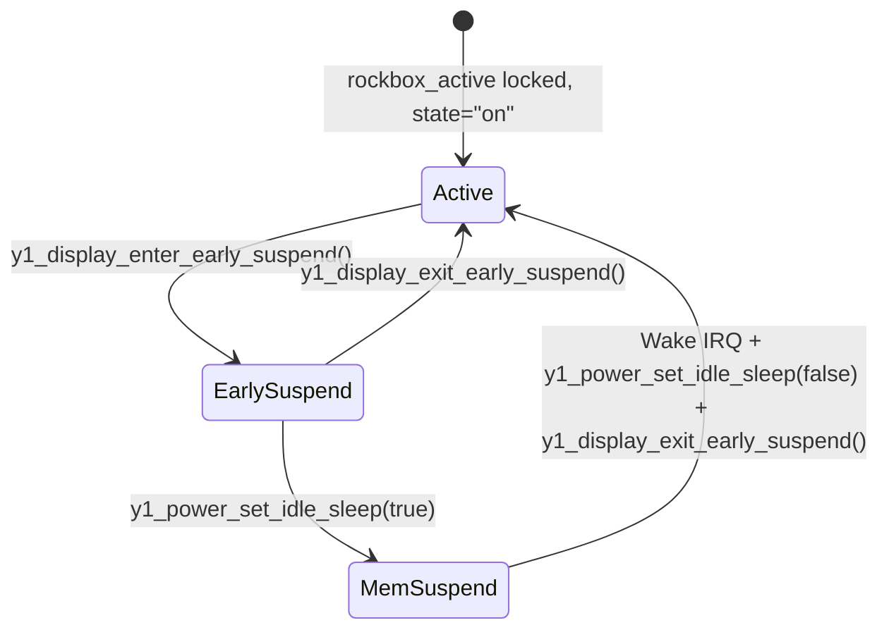

🌐 [한국어](kr/POWER_MANAGEMENT.md) | **English**

# Power Management: Innioasis Y1

This document describes the power management mechanisms implemented in the Nugget Linux environment and `liby1` on the MediaTek MT6572 / MT6323 hardware platform.

---

## 1. Kernel Suspend & Wakelock Architecture

Downstream MediaTek kernel 3.4.67 uses Android `earlysuspend` and `wakelock` sysfs interfaces (`/sys/power/state`, `/sys/power/wake_lock`, `/sys/power/wake_unlock`).

### 1.1 Display Early-Suspend vs. Full `mem` Suspend

- **Early-Suspend (`y1_display_enter_early_suspend()`):**
  - Acquires `"rockbox_active"` in `/sys/power/wake_lock` and writes `"mem\n"` to `/sys/power/state`.
  - Because a userspace wakelock is held, kernel `earlysuspend` handlers power down the display controller, backlight, touch scan, and GPU without freezing userspace processes (used during screen-off audio playback).
- **Full `mem` Suspend (`y1_power_set_idle_sleep(true)`):**
  - Skipped if USB Mass Storage is attached (`y1_usb_is_storage_attached()`).
  - Unlocks `"rockbox_active"` and `"y1play"` in `/sys/power/wake_unlock` and writes `"mem\n"` to `/sys/power/state`, allowing the kernel to enter `mem` suspend (RAM retention, userspace frozen) when audio DMA is idle.
- **Resume (`y1_power_set_idle_sleep(false)` + `y1_display_exit_early_suspend()`):**
  - Re-acquires `"rockbox_active"` in `/sys/power/wake_lock` and writes `"on\n"` to `/sys/power/state`.

### 1.2 Audio Playback Wakelock & SPM Deep-Idle

- `y1_audio_wake_lock(true)` / `y1_audio_wake_lock(false)` holds or releases `"y1play"` in `/sys/power/wake_lock` / `/sys/power/wake_unlock` so `mem` suspend is prevented while audio playback is active.
- `y1_audio_set_deep_idle(false)` disables MT6572 SPM CPU powerdown while AFE DL1 DMA is running so DMA transfers are not interrupted; `y1_audio_set_deep_idle(true)` re-enables it when audio stops.

---

## 2. CPU Frequency & Core Hotplug Control

### 2.1 Kernel Sysfs Interfaces
- Frequency governor/speed: `/sys/devices/system/cpu/cpu0/cpufreq/` (`scaling_governor`, `scaling_setspeed`)
- Core 1 hotplug: `/sys/devices/system/cpu/cpu1/online` (`0` = offline, `1` = online)

### 2.2 `liby1` CPU Modes (`enum y1_cpu_mode_id`)

| Mode | Constant | Behavior |
| :--- | :--- | :--- |
| Dynamic | `Y1_CPU_MODE_DYNAMIC` (`0`) | `ondemand` governor (598 MHz – 1001 MHz) |
| Powersave | `Y1_CPU_MODE_POWERSAVE` (`1`) | Fixed 598 MHz |
| Balanced | `Y1_CPU_MODE_BALANCED` (`2`) | Fixed 1001 MHz |
| Performance | `Y1_CPU_MODE_PERFORMANCE` (`3`) | Fixed 1196 MHz |
| Turbo | `Y1_CPU_MODE_TURBO` (`4`) | Fixed 1300 MHz |

- `y1_cpu_set_dual_core(bool dual_core)` enables or offlines CPU1 via `/sys/devices/system/cpu/cpu1/online`.
- `y1_cpu_set_screen_off_clamp(bool screen_off)` clamps CPU frequency and offlines CPU1 when the display is off.
- `y1_cpu_boost_for_conversion(bool enable)` temporarily raises CPU frequency/cores during bulk database or artwork processing and restores the prior mode when disabled.

---

## 3. Peripheral Power-Down When Idle

- **Display Eco Mode:** `y1_fb_set_eco_mode(true)` writes `/proc/dispsys/eco_mode`.
- **Touch Scanning:** `y1_input_set_touch_scanning(false)` disables touch-wheel scanning via `/proc/tpd_keys_enable`.
- **Audio Analog Stage:** Closing `/dev/eac` (`y1_audio_close()`) powers down the MT6323 headphone amplifier and DAC bias after draining settling samples.
