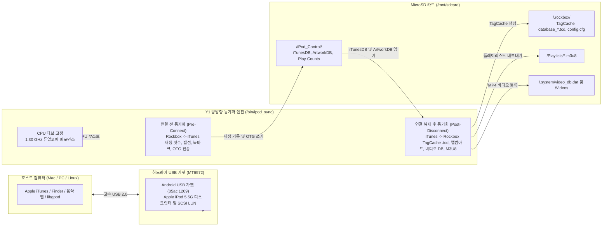

🌐 [English](../IPOD_SYNC.md) | **한국어**

# iPod 5.5G USB 모드 및 양방향 iTunes 동기화 엔진

Nugget for Innioasis Y1은 기기 내에서 동작하는 양방향 동기화 엔진과 Apple iPod 5.5세대(Enhanced Video) 하드웨어 스푸핑 서브시스템을 탑재하고 있습니다.

이를 통해 Innioasis Y1을 **Apple iTunes(Windows 및 macOS)**, **macOS Finder / 음악 앱**, 또는 서드파티 관리 프로그램(**libgpod**, **Foobar2000 foo_dop**, **MediaMonkey**, **Clementine**)에 연결했을 때 정품 80GB iPod Video(5.5세대, 모델명 `MA448` / `MA450`)로 완벽하게 인식됩니다.



---

## 목차
1. [하드웨어 스푸핑 (iPod 5.5세대 Enhanced)](#1-하드웨어-스푸핑-ipod-55세대-enhanced)
2. [양방향 동기화 아키텍처](#2-양방향-동기화-아키텍처)
   - [2.1 연결 전 단계 (Rockbox → iTunes)](#21-연결-전-단계-rockbox--itunes)
   - [2.2 연결 해제 후 단계 (iTunes → Rockbox)](#22-연결-해제-후-단계-itunes--rockbox)
3. [구성 요소 및 메타데이터 변환 상세](#3-구성-요소-및-메타데이터-변환-상세)
   - [3.1 TagCache 바이너리 데이터베이스 생성](#31-tagcache-바이너리-데이터베이스-생성)
   - [3.2 앨범 아트 및 비디오 썸네일 추출](#32-앨범-아트-및-비디오-썸네일-추출)
   - [3.3 비디오 서브시스템 통합 (`video_db.dat`)](#33-비디오-서브시스템-통합-video_dbdat)
   - [3.4 플레이리스트 및 실시간 스마트 재생목록 규칙 (`.m3u8`)](#34-플레이리스트-및-실시간-스마트-재생목록-규칙-m3u8)
   - [3.5 재생 횟수, 별점 및 즉석 재생목록 (OTG)](#35-재생-횟수-별점-및-즉석-재생목록-otg)
4. [CPU 클럭 및 듀얼코어 터보 고정](#4-cpu-클럭-및-듀얼코어-터보-고정)
5. [사용자 설정 및 환경 구성](#5-사용자-설정-및-환경-구성)
6. [독립 CLI 유틸리티 (`/bin/ipod_sync`)](#6-독립-cli-유틸리티-binipod_sync)
7. [호스트 호환성 가이드](#7-호스트-호환성-가이드)

---

## 1. 하드웨어 스푸핑 (iPod 5.5세대 Enhanced)

**iPod USB 모드**가 활성화되면 Linux 커널 가젯 드라이버가 MediaTek 기본 USB 디스크립터를 정품 Apple iPod 5.5세대 파라미터로 대체합니다:

| 파라미터 | 값 | 의미 / 호환성 |
| :--- | :--- | :--- |
| **USB 벤더 ID (VID)** | `0x05ac` | Apple, Inc. |
| **USB 프로덕트 ID (PID)** | `0x1209` | iPod Video 5.5세대 (Enhanced) |
| **장치 릴리즈 (bcdDevice)** | `0x0002` | 펌웨어 1.2 / 1.3 프로토콜 리비전 |
| **제조사 문자열** | `Apple` | Apple Mobile Device Service 인식 필수 항목 |
| **제품명 문자열** | `iPod` | Apple 표준 USB 식별자 |
| **USB 시리얼 번호** | `000A270019B48C1F` (또는 지속성 16진수 GUID) | `/iPod_Control/Device/SysInfo` 기반 생성 |
| **SCSI Vendor / Inquiry** | `"Apple   iPod            1.62"` | 대용량 저장소 LUN을 정품 iPod 디스크로 식별 |
| **기기 모델 번호** | `MA448` / `MA450` (80GB 블랙 / 화이트) | `SysInfoExtended` XML 프로퍼티로 보고 |

### 기기 초기화 파일
USB 케이블이 연결되면 `liby1`은 필요한 디렉터리와 식별 파일을 자동으로 구성합니다:
- `/iPod_Control/Device/SysInfo`: 보드 리비전(`0x000C0005`), 일련번호, FireWire GUID, 패밀리 ID(`0x0000000C`) 기록.
- `/iPod_Control/Device/SysInfoExtended`: 펌웨어 기능, 지원 이미지 포맷(포맷 1027, 1031, 1055, 1060), 비디오 프로파일 XML 리스트.
- 루트 심볼릭 링크: 대소문자 구분 호환성을 위해 `/ipod_control`, `/IPOD_CONTROL`을 `/mnt/sdcard/iPod_Control`로 연결.

---

## 2. 양방향 동기화 아키텍처

동기화 파이프라인은 완전한 **양방향**이며, PC 측 별도 에이전트 프로그램 없이 Y1 기기의 듀얼코어 프로세서에서 자체 구동됩니다.

### 2.1 연결 전 단계 (Rockbox → iTunes)
Y1이 PC에 연결되거나 부트로더 메뉴에서 5번(USB Mass Storage)을 선택했을 때, PC에 USB 저장소가 마운트되기 직전에 `y1_ipod_sync_pre_connect()`가 실행됩니다:

1. **CPU 1300 MHz 듀얼코어 터보 잠금**: 호스트 열거(Enumeration) 지연을 방지하기 위해 최대 성능으로 신속하게 처리합니다.
2. **Rockbox 런타임 재생 지표 수집**: Rockbox 런타임 데이터베이스가 기록한 재생 횟수, 마지막 재생 시각, 별점을 로드합니다.
3. **`/iPod_Control/iTunes/Play Counts` 생성**:
   - `0x60` 바이트 크기의 Apple `mhdp` 헤더를 생성합니다.
   - 변경된 트랙마다 `0x1c` 바이트 재생 레코드를 기록하여 재생 횟수 델타(증가분), Mac 에포크 타임스탬프, 북마크 위치(밀리초), 별점을 저장합니다.
4. **`iTunesDB` `mhit` 레코드 직접 패치**: `iTunesDB`를 직접 파싱하는 프로그램들을 위해 별점 및 북마크 위치를 인플레이스(in-place)로 패치합니다.
5. **즉석 재생목록 (On-The-Go) 내보내기**:
   - Rockbox에서 생성된 큐/OTG 재생목록을 읽어 `/iPod_Control/iTunes/OTGPlaylistInfo`(`mhpo` 포맷)로 내보냅니다.
   - iTunes와 동기화 시 기기에서 담은 노래들을 새 재생목록으로 가져올 수 있습니다.
6. **버퍼 플러시 및 캐시 동기화**: `sync()`를 호출하여 파일시스템 일관성을 확보한 후 호스트에 블록 디바이스를 노출합니다.
7. **USB 가젯 활성화**: 호스트 PC가 SD 카드를 마운트할 수 있도록 허용합니다.

### 2.2 연결 해제 후 단계 (iTunes → Rockbox)
PC에서 볼륨을 언마운트(꺼내기)하거나 USB 케이블을 분리하면:

1. **USB 가젯 분리 및 캐시 드롭**: 저장소 LUN을 언바인드하고 `/proc/sys/vm/drop_caches`에 `3`을 기록하여 지연 캐시를 제거합니다.
2. **`iTunesDB` 수정 시간 검사**: 연결 전 기록된 파일 수정 시각과 비교하여 변경 사항이 없으면 무거운 변환 작업을 즉시 건너뜁니다.
3. **CPU 1300 MHz 듀얼코어 터보 잠금**: 초고속 변환 처리를 위해 2개 코어를 최고 클럭으로 활성화합니다.
4. **`iTunesDB` 구문 분석**: 음악, 팟캐스트, 오디오북, 비디오 트랙 메타데이터 및 파일 경로(콜론 `:` 경로를 POSIX `/mnt/sdcard/...` 경로로 변환)를 읽습니다.
5. **앨범 아트 및 비디오 썸네일 디코딩**: `ArtworkDB` 및 연관된 `.ithmb` 컨테이너 파일을 읽어 이미지 데이터를 추출합니다.
6. **Rockbox `TagCache` 바이너리 생성**: `/.rockbox/` 디렉터리에 `.tcd` 데이터베이스를 직접 빌드하여, 부팅 후 수동 "데이터베이스 업데이트" 스캔 없이 즉시 아티스트/앨범별 탐색이 가능합니다.
7. **비디오 데이터베이스 병합**: 동영상 트랙(영화, 뮤직비디오, TV 프로그램)을 `/.system/video_db.dat`에 등록하여 Y1 하드웨어 가속 비디오 플레이어에서 즉시 감상할 수 있습니다.
8. **재생목록 및 스마트 재생목록 변환**: 표준 재생목록 및 스마트 규칙을 `/Playlists/` 폴더 내 UTF-8 `.m3u8` 파일로 생성합니다.
9. **메모리 내 TagCache 즉시 리로드**: 재부팅 없이 Rockbox 재생 엔진이 새 데이터베이스를 바로 읽도록 시그널을 전달합니다.

---

## 3. 구성 요소 및 메타데이터 변환 상세

### 3.1 TagCache 바이너리 데이터베이스 생성
Rockbox는 고유의 바이너리 TagCache 형식(`database_*.tcd`)을 사용합니다. Y1 동기화 엔진은 완벽하게 호환되는 데이터베이스를 즉석에서 생성합니다:

- **포맷 버전**: `0x54434811` (Rockbox TagCache 2.12 규격).
- **태그 수**: 24개 표준 태그(아티스트, 앨범, 제목, 장르, 트랙번호, 연도, 디스크번호, 파일명, 경로, 작곡가, 코멘트, 앨범아티스트, 그룹 등).
- **청크 크기**: 4바이트 해시 정렬 및 청크당 8개 항목.
- **폴백 로직**: `AlbumArtist`가 비어있을 경우 `Artist`로 자동 보정하며, 클래식/팟캐스트 그룹핑을 Rockbox `Grouping` 태그에 매핑합니다.

### 3.2 앨범 아트 및 비디오 썸네일 추출
iTunes는 앨범 아트를 독자 규격의 픽셀 스트림인 `.ithmb` 파일에 보관합니다:

1. **Rockbox용 커버 아트**:
   - 포맷 `1027`(100x100 RGB565) 또는 `1055`(320x320 RGB565)를 탐색합니다.
   - 24비트 무압축 Windows Bitmap(`.bmp`)으로 변환합니다.
   - 트랙과 같은 디렉터리(`cover.bmp` 또는 트랙명 기반 `.bmp`)에 저장하여 Rockbox 앨범아트 로더가 즉시 로드하도록 합니다.
2. **Y1 비디오 플레이어용 썸네일**:
   - 포맷 `1031`(96x72 RGB565) 썸네일을 추출합니다.
   - Rockbox 표준 `rockbox_crc32()` 알고리즘으로 동영상 경로의 빅엔디언 CRC32를 계산합니다:
     $$\text{다항식} = \mathtt{0x04C11DB7}, \quad \text{초기값} = \mathtt{0xFFFFFFFF}, \quad \text{최종 XOR 없음}$$
   - `/.rockbox/video_thumbs/<CRC32_HEX>.rgb`로 저장하여 비디오 목록 탐색 시 렉 없이 즉시 표시합니다.

### 3.3 비디오 서브시스템 통합 (`video_db.dat`)
iTunes에서 MP4/M4V 동영상을 동기화하면:
- `/mnt/sdcard/.system/video_db.dat`에 동영상 메타데이터를 자동 등록합니다.
- 제목, 재생 시간, 해상도 및 시리즈/에피소드 정보가 보존됩니다.
- Y1 **비디오 플레이어** 앱 및 Rockbox 비디오 플러그인에서 별도 스캔 없이 바로 재생할 수 있습니다.

### 3.4 플레이리스트 및 실시간 스마트 재생목록 규칙 (`.m3u8`)
`iTunesDB`에 저장된 재생목록(`mhyp`)은 `/Playlists/` 디렉터리에 UTF-8 `.m3u8` 파일로 변환됩니다:
- **폴더 재생목록**: iTunes 재생목록 폴더 구조를 감지하여 하위 디렉터리로 계층 구조를 그대로 보존합니다.
- **스마트 재생목록 (`SLst`)**:
  - 엔진이 `SLst` 바이트코드를 실시간으로 파싱합니다.
  - 조건문(`AND` / `OR`), 트랙 개수 제한(예: "노래 100개로 제한"), 장르/아티스트 필터, 재생 횟수 조건, 별점 필터를 연산하여 최신 목록으로 내보냅니다.

### 3.5 재생 횟수, 별점 및 즉석 재생목록 (OTG)
- **별점 동기화**:
  - Rockbox: `0`(평가 없음) 또는 `1~5`개 별점.
  - iTunes: `0~100` 스케일(`20` = 별 1개, `40` = 별 2개, `60` = 별 3개, `80` = 별 4개, `100` = 별 5개).
  - 양방향 스케일 변환을 통해 기기와 PC 양쪽에서 별점이 완벽하게 유지됩니다.
- **북마크 이어듣기**: Y1에서 듣다 멈춘 위치(ms)가 iTunes로 전송되어 데스크톱에서도 이어서 들을 수 있습니다.
- **재생 횟수**: 델타(증가분) 방식 기록을 통해 마스터 재생 카운트를 덮어쓰지 않고 정확하게 누적합니다.

---

## 4. CPU 클럭 및 듀얼코어 터보 고정

수천 곡의 메타데이터 변환, `.ithmb` 이미지 디코딩, TagCache 해싱은 연산량이 큽니다. 일반 재생 중 배터리 소모를 최소화하면서도 동기화 변환 시간을 단축하기 위해 `liby1`의 **참조 카운팅 터보 부스트**(`y1_cpu_boost_for_conversion`)를 적용합니다:

```c
// 변환을 위한 최대 성능 터보 모드 활성화
y1_cpu_boost_for_conversion(true);

/*
 * 1. CPU0 거버너 -> "performance"
 * 2. CPU0 클럭   -> "1300000" (1.30 GHz)
 * 3. CPU1 코어   -> "1" (코어 1 강제 활성화)
 * 4. CPU1 거버너 -> "performance"
 * 5. MediaTek 핫플러그 비활성화 (코어 오프라인 방지)
 */

// 고속 변환 수행...

// 작업 완료 후 기존 클럭 및 거버너로 자동 복원
y1_cpu_boost_for_conversion(false);
```

변환 중에는 화면에 실시간 진행률이 표시됩니다:
```
[====================>        ] 72%
Converting: Album Art (342/480)...
```

---

## 5. 사용자 설정 및 환경 구성

iPod USB 모드는 기본 활성화되어 있으며, 화면 메뉴 또는 설정 파일에서 언제든지 전환할 수 있습니다.

### 1. Rockbox UI 설정
- 진입 경로: **설정 → 일반 설정 → 시스템 → Innioasis Y1 설정 → iPod USB 모드**
- 선택 옵션: **예 (iPod 5.5세대)** / **아니오 (일반 대용량 저장소)**
- **아니오**로 설정할 경우 MediaTek 기본 USB 저장소(`0e8d:0001` / `Y1 Rockbox Player`)로 동작합니다.

### 2. 설정 파일 구성
- **Rockbox 설정 파일**: `/.rockbox/config.cfg`
  ```ini
  y1 ipod usb mode: on
  ```
- **시스템 플래그 (initramfs 확인용)**: `/.system/ipod_usb_mode`
  - `1`: 활성화
  - `0`: 비활성화

---

## 6. 독립 CLI 유틸리티 (`/bin/ipod_sync`)

동기화 엔진은 루트 파일시스템 내 경량 네이티브 바이너리(`/bin/ipod_sync`)로 빌드되어 제공됩니다:

```bash
# iPod 디렉터리 구조 및 기기 식별 파일 초기화
/bin/ipod_sync init

# 연결 전 동기화 실행 (Rockbox -> iTunes)
/bin/ipod_sync pre

# 연결 해제 후 변환 실행 (iTunes -> Rockbox)
/bin/ipod_sync post
```

쉘 스크립트나 터미널 세션, 커스텀 애플리케이션에서 직접 호출하여 활용할 수 있습니다.

---

## 7. 호스트 호환성 가이드

| 호스트 플랫폼 | 지원 소프트웨어 | 특징 |
| :--- | :--- | :--- |
| **Windows 10 / 11** | Apple iTunes 12.x (독립설치형 / 스토어형) | 음악, 비디오, 플레이리스트, 앨범아트, 재생기록 완벽 동기화 |
| **Windows (전체)** | Foobar2000 + `foo_dop` 컴포넌트 | 매우 가볍고 강력한 iPod 동기화 지원 |
| **Windows (전체)** | MediaMonkey 4 / 5 | iPod 완벽 인식 및 동기화 지원 |
| **macOS (Mojave 이하)** | Apple iTunes | 네이티브 iPod 동기화 지원 |
| **macOS (Catalina ~ Sequoia)** | Apple 음악 앱 / Finder | Finder 사이드바에서 iPod 장비로 직접 관리 |
| **Linux (전체 배포판)** | `libgpod` / Rhythmbox / Clementine | `iTunesDB` 및 앨범아트 완벽 읽기/쓰기 |
| **크로스 플랫폼** | MusicBee, Strawberry Music Player | 표준 Apple iPod 대용량 저장소로 자동 인식 |

---

## 8. Windows 및 iTunes 문제 해결 가이드

Windows에서 장치 드라이버는 정상적으로 설치되었으나 iTunes 화면에 iPod 아이콘이 나타나지 않는 경우:

1. **MicroSD FAT32 파일 시스템 요구사항**:
   - Windows용 Apple iTunes는 클래식 iPod에 대해 **FAT32** 파일 시스템만을 지원합니다.
   - 만약 MicroSD 카드가 **exFAT** 또는 NTFS로 포맷되어 있다면 탐색기에는 드라이브가 마운트되지만 iTunes는 이를 iPod으로 인식하지 않고 무시합니다.
   - **해결 방법**: MicroSD 카드를 FAT32로 포맷하십시오 (32GB 초과 카드는 *GUIFormat* / *FAT32 Format* 등의 유틸리티 사용 권장).

2. **Apple iTunes 독립 데스크톱 설치 프로그램 권장**:
   - 마이크로소프트 스토어(MS Store) 버전의 iTunes는 샌드박스 정책으로 인해 `iPod Support Service` 백그라운드 권한이나 USB 리디렉션 드라이버가 누락되는 경우가 많습니다.
   - **해결 방법**: Apple 공식 웹사이트에서 제공하는 독립 실행형 64비트 설치 프로그램(`iTunes64Setup.exe`)을 설치하십시오. `services.msc`에서 `Apple Mobile Device Support` 및 `iPod Support` 서비스가 실행 중인지 확인하십시오.

3. **장치 관리자(Device Manager) 확인 (단일 LUN vs 2x 드라이브)**:
   - **디스크 드라이브** 항목에 **정확히 1개의** `Apple___ iPod____________ USB Device`가 표시되어야 합니다.
   - **범용 직렬 버스 컨트롤러** 항목에는 `USB 대용량 저장 장치(USB Mass Storage Device)`로 표시되는 것이 iPod Classic/Video 5.5G (`05ac:1209`)의 정상 동작입니다.
   - 만약 **`2x Apple___ iPod____________ USB Device`** 로 중복 표시되는 경우:
     - 미디어텍 MT6572 커널은 `nluns = 2`로 하드코딩되어 있습니다. 커널의 `f_mass_storage.c`에서 `bicr == 0`일 때 USB `GET_MAX_LUN` 제어 요청이 `max_lun = nluns - 1 = 1`을 반환하여 호스트에게 2개의 LUN(0과 1)이 존재한다고 알립니다. 두 LUN 모두 동일한 Inquiry 문자열을 공유하므로 장치 관리자에 2개의 디스크 장치가 생성됩니다.
     - iTunes의 `iPodService`는 다중 LUN을 가진 USB 저장 장치를 감지하면 정품 iPod이 아닌 멀티 카드 리더기나 가상 드라이브로 판별하여 동기화를 즉시 거부합니다.
     - 최신 Nugget에서는 `bicr` 값을 `2`로 설정합니다. 미디어텍 커널 내부 로직에 의해:
       1) `bicr != 0`이 되어 `GET_MAX_LUN`이 `0`을 반환하므로 호스트에 **단 1개의 LUN만** 노출됩니다.
       2) `bicr != 1`이므로 CD-ROM 비트가 해제(`curlun->cdrom = 0`)되어 SCSI 직접 액세스 디스크(`0x00`)로 동작합니다.
     - **해결 조치**: 장치 관리자에서 기존에 중복 생성된 `Apple___ iPod____________ USB Device` 2개를 모두 우클릭하고 **디바이스 제거**를 선택한 후, USB 케이블을 분리했다가 다시 연결하십시오.

4. **단일 LUN (Single-LUN) 아키텍처 및 BICR = 2**:
   - Nugget은 iPod USB 모드 활성화 시 `bicr = 2`를 통해 `GET_MAX_LUN = 0`을 엄격히 강제하여 호스트에 오직 LUN0만 노출시킵니다.
