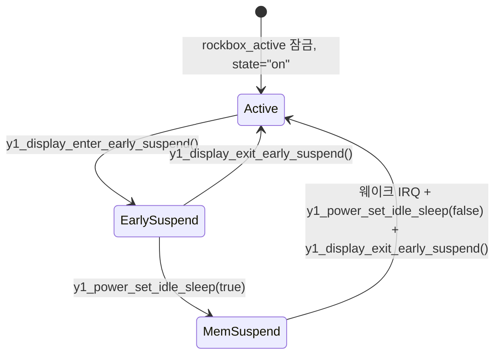

🌐 **한국어** | [English](../POWER_MANAGEMENT.md)

# 전원 관리: Innioasis Y1

본 문서는 MediaTek MT6572 / MT6323 하드웨어 플랫폼에서 Nugget 리눅스 환경 및 `liby1`이 구현하는 전원 관리 메커니즘을 설명합니다.

---

## 1. 커널 절전 및 Wakelock 아키텍처

다운스트림 리눅스 커널 3.4.67은 안드로이드 `earlysuspend` 및 `wakelock` sysfs 인터페이스(`/sys/power/state`, `/sys/power/wake_lock`, `/sys/power/wake_unlock`)를 사용합니다.

### 1.1 디스플레이 Early-Suspend vs. 전체 `mem` 절전

- **Early-Suspend (`y1_display_enter_early_suspend()`):**
  - `/sys/power/wake_lock`에 `"rockbox_active"`를 획득한 상태에서 `/sys/power/state`에 `"mem\n"`을 기록합니다.
  - 유저스페이스 wakelock이 유지되므로 커널 `earlysuspend` 핸들러가 유저스페이스 프로세스를 정지시키지 않고 디스플레이 컨트롤러, 백라이트, 터치 스캔, GPU 전원만 차단합니다(화면이 꺼진 상태의 오디오 재생에 사용).
- **전체 `mem` 절전 (`y1_power_set_idle_sleep(true)`):**
  - USB 대용량 저장소가 연결된 경우(`y1_usb_is_storage_attached()`)에는 건너뜁니다.
  - `/sys/power/wake_unlock`에서 `"rockbox_active"` 및 `"y1play"`를 해제하고 `/sys/power/state`에 `"mem\n"`을 기록하여 오디오 DMA가 유휴 상태일 때 커널이 `mem` 절전(RAM 유지, 유저스페이스 동결)에 진입할 수 있도록 합니다.
- **복귀 (`y1_power_set_idle_sleep(false)` + `y1_display_exit_early_suspend()`):**
  - `/sys/power/wake_lock`에 `"rockbox_active"`를 다시 획득하고 `/sys/power/state`에 `"on\n"`을 기록합니다.

### 1.2 오디오 재생 Wakelock 및 SPM Deep-Idle

- `y1_audio_wake_lock(true)` / `y1_audio_wake_lock(false)`는 오디오 재생 중 `mem` 절전 진입을 방지하기 위해 `"y1play"` wakelock을 획득/해제합니다.
- `y1_audio_set_deep_idle(false)`는 AFE DL1 DMA가 동작하는 동안 DMA 언더런이 발생하지 않도록 MT6572 SPM CPU 전원 차단을 비활성화하며, 오디오가 정지하면 `y1_audio_set_deep_idle(true)`로 다시 허용합니다.

---

## 2. CPU 주파수 및 코어 핫플러그 제어

### 2.1 커널 Sysfs 인터페이스
- 주파수 거버너/속도: `/sys/devices/system/cpu/cpu0/cpufreq/` (`scaling_governor`, `scaling_setspeed`)
- 코어 1 핫플러그: `/sys/devices/system/cpu/cpu1/online` (`0` = 오프라인, `1` = 온라인)

### 2.2 `liby1` CPU 모드 (`enum y1_cpu_mode_id`)

| 모드 | 상수 | 동작 |
| :--- | :--- | :--- |
| Dynamic | `Y1_CPU_MODE_DYNAMIC` (`0`) | `ondemand` 거버너 (598 MHz – 1001 MHz) |
| Powersave | `Y1_CPU_MODE_POWERSAVE` (`1`) | 고정 598 MHz |
| Balanced | `Y1_CPU_MODE_BALANCED` (`2`) | 고정 1001 MHz |
| Performance | `Y1_CPU_MODE_PERFORMANCE` (`3`) | 고정 1196 MHz |
| Turbo | `Y1_CPU_MODE_TURBO` (`4`) | 고정 1300 MHz |

- `y1_cpu_set_dual_core(bool dual_core)`는 `/sys/devices/system/cpu/cpu1/online`을 통해 CPU1을 활성화하거나 오프라인합니다.
- `y1_cpu_set_screen_off_clamp(bool screen_off)`는 화면이 꺼졌을 때 CPU 주파수를 제한하고 CPU1을 오프라인합니다.
- `y1_cpu_boost_for_conversion(bool enable)`은 대용량 데이터베이스 또는 앨범아트 처리 중 일시적으로 CPU 클록/코어를 상향하고 비활성화 시 이전 모드를 복원합니다.

---

## 3. 유휴 시 주변 장치 전원 차단

- **디스플레이 에코 모드:** `y1_fb_set_eco_mode(true)`는 `/proc/dispsys/eco_mode`를 설정합니다.
- **터치 스캔:** `y1_input_set_touch_scanning(false)`는 `/proc/tpd_keys_enable`을 통해 터치 휠 스캔을 비활성화합니다.
- **오디오 아날로그 스테이지:** `/dev/eac`를 닫을 때(`y1_audio_close()`) 안정화 샘플을 출력한 후 MT6323 헤드폰 앰프 및 DAC 바이어스 전원을 차단합니다.
