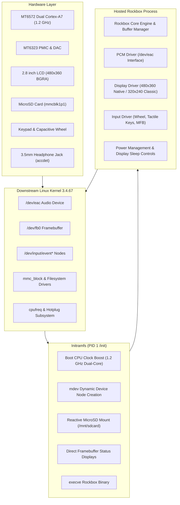
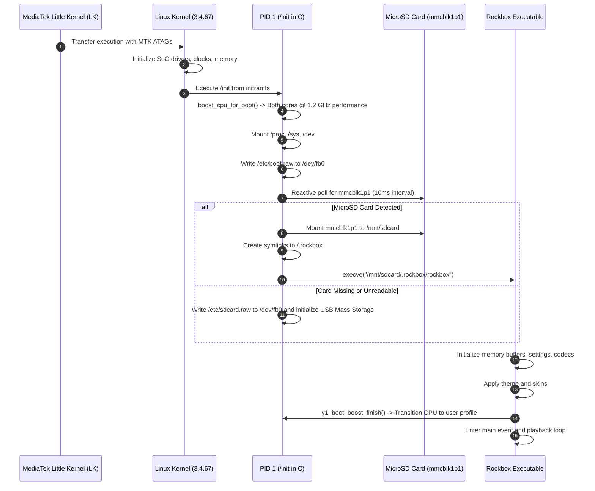

🌐 [한국어](kr/ARCHITECTURE.md) | **English**

# System Architecture: Innioasis Y1 Hosted Linux Port

This document details the software architecture, process model, boot lifecycle, and storage layout of the Innioasis Y1 Rockbox port on downstream minimal Linux.

---

## 1. System Block Diagram



---

## 2. Boot Sequence & Process Lifecycle



---

## 3. Storage Hierarchy & Partitioning

The hardware contains internal eMMC (`mmcblk0`) and external MicroSD (`mmcblk1`).

### 3.1 Partition Scheme
- `mmcblk0` (Internal eMMC): Contains stock MediaTek partitions (`BOOTIMG`, `RECOVERY`, `LOGO`, `SYSTEM`, `CACHE`, `DATA`). Rockbox overwrites only the `BOOTIMG` partition with `boot_rockbox.img` (6 MiB max). The rest of eMMC is left unmounted.
- `mmcblk1p1` (External MicroSD): Formatted as FAT32, exFAT, NTFS, or ext4. Acts as the primary root storage drive for Rockbox:
  ```text
  /mnt/sdcard/
  |-- .rockbox/
  |   |-- rockbox          # ELF ARM hard-float executable
  |   |-- codecs/          # Audio decoders (.codec)
  |   |-- rocks/           # Plugins and viewers (.rock, .ovl)
  |   |-- fonts/           # UI fonts (.fnt, .fnticons)
  |   |-- themes/          # Theme configurations (.cfg)
  |   |-- wps/             # While Playing Screen skins (.wps, .sbs)
  |   |-- config.cfg       # Persisted settings
  |   `-- boot.raw         # Custom bootscreen
  `-- Music/               # Media library
  ```

---

## 4. Hardware Abstraction Layer (HAL) Mapping

| Subsystem | File Path | Technical Role |
| :--- | :--- | :--- |
| PCM Audio | [`firmware/target/hosted/innioasis/y1/pcm-y1.c`](file:///c:/Users/dakirb/Documents/rom/!rockbox_fromsource/rockbox-master/rockbox-master/firmware/target/hosted/innioasis/y1/pcm-y1.c) | Communicates with `/dev/eac`. Handles 44.1/48kHz clock changes and pop suppression. |
| Audio Controls | [`firmware/target/hosted/innioasis/y1/audio-y1.c`](file:///c:/Users/dakirb/Documents/rom/!rockbox_fromsource/rockbox-master/rockbox-master/firmware/target/hosted/innioasis/y1/audio-y1.c) | Headphone amplifier analog gain (+12dB) and mute GPIO lines. |
| CPU Frequency | [`firmware/target/hosted/innioasis/y1/cpufreq-y1.c`](file:///c:/Users/dakirb/Documents/rom/!rockbox_fromsource/rockbox-master/rockbox-master/firmware/target/hosted/innioasis/y1/cpufreq-y1.c) | Governor control, core offlining, screen-off throttling, and boot boost completion. |
| LCD / Display | [`firmware/target/hosted/innioasis/y1/lcd-y1.c`](file:///c:/Users/dakirb/Documents/rom/!rockbox_fromsource/rockbox-master/rockbox-master/firmware/target/hosted/innioasis/y1/lcd-y1.c) | Framebuffer writing (`/dev/fb0`), 480x360 native / 320x240 stretched scaling, 1 FPS AOD refresh. |
| Keypad & Wheel | [`firmware/target/hosted/innioasis/y1/button-y1.c`](file:///c:/Users/dakirb/Documents/rom/!rockbox_fromsource/rockbox-master/rockbox-master/firmware/target/hosted/innioasis/y1/button-y1.c) | Translates `evdev` events from click wheel and buttons into Rockbox `BUTTON_*` codes. |
| Power & Battery | [`firmware/target/hosted/innioasis/y1/power-y1.c`](file:///c:/Users/dakirb/Documents/rom/!rockbox_fromsource/rockbox-master/rockbox-master/firmware/target/hosted/innioasis/y1/power-y1.c) | Battery voltage and charge status reading from MT6323 sysfs. |

