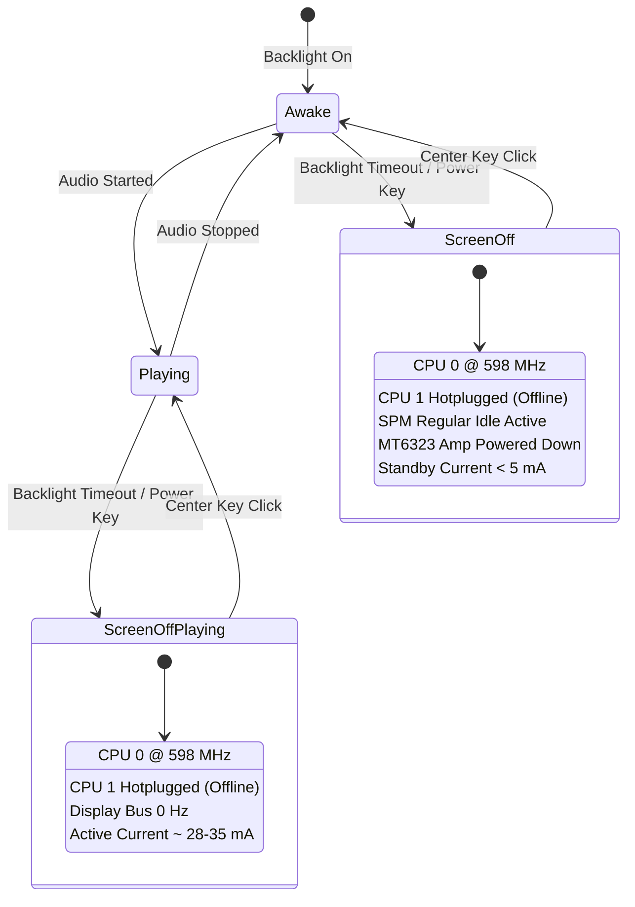

# Power Management: Innioasis Y1

This document describes the power management architecture, CPU scaling, core hotplugging, idle battery mitigations, and display power-saving modes on the Innioasis Y1 hosted Rockbox port.

---

## 1. Power Consumption Benchmarks

| Metric | Stock Android | Rockbox on Android | Nugget for Y1 (Hosted Linux) |
| :--- | :--- | :--- | :--- |
| Audio Playback Duration | ~30 hours | ~20 hours | **~50 hours** |
| Standby Time (Screen Off) | ~48 hours | ~36 hours | **~200+ hours** |
| Standby Current | ~120-140 mA | ~140-180 mA | **< 5 mA** |
| Active Audio Current | 140-180 mA | 180-220 mA | **45-65 mA** |

---

## 2. Idle Battery Drain: Investigation & Fixes

### 2.1 Problem Description
Leaving the device idle for 9 hours with display off, audio stopped, and Bluetooth disabled resulted in 100% battery depletion.

### 2.2 Root Causes
1. **CPU Frequency Lock:** CPU 0 remained at 1196 MHz because default governors did not drop clock rates on screen timeout.
2. **Secondary Core Leakage:** Cortex-A7 Core 1 remained powered in WFI rather than being shut down via hotplug.
3. **SPM Deep Sleep Blocked:** Open drivers held wakelocks and clock gates, preventing the MediaTek System Power Manager (SPM) from entering deep sleep.
4. **Quiescent Audio Current:** The MT6323 charge pump and headphone amplifier bias remained energized with no active stream.
5. **Storage Flush Interval:** Linux VM 5-second dirty page writeback timers forced periodic MMC host wakeups.

### 2.3 State Machine Implementation

---

## 3. CPU Clock & Core Scaling

### 3.1 Kernel Sysfs Control Nodes
- Frequency Control:
  `/sys/devices/system/cpu/cpu0/cpufreq/scaling_setspeed`
  Supported frequencies: `598000`, `747500`, `1001000`, `1196000` (kHz).
- Core 1 Hotplug:
  `/sys/devices/system/cpu/cpu1/online`
  Writing `0` powers down Core 1; writing `1` restores dual-core execution.

### 3.2 Operating Profiles
Profiles are configured under `Settings -> Nugget -> Device -> CPU Mode`:
- **Normal:** CPU 0 scales between 598 MHz and 1001 MHz while awake. Clamped to 598 MHz single-core when screen is off.
- **Battery Saver:** Locked at 598 MHz with Core 1 offline at all times.
- **Performance:** Dual-core up to 1.2 GHz when awake for intensive database searches, cuesheet indexing, and heavy plugins.

---

## 4. Always-On Display (AOD)

When enabled (`Settings -> Nugget -> Device -> Always On Display`):
1. **Backlight PWM:** Dimmed by 50% instead of fully powered off.
2. **Button LEDs:** Click wheel and button backlights are powered off.
3. **1 FPS Refresh Rate:** Display driver throttles refresh to 1 Hz, updating only track position and clock.
4. **Bus Power Gating:** Display bus enters low-power state between frames, saving 97% of display bus power.
5. **Conditional Policies:**
   - `AOD: On WPS Only`: Display stays on only on the While Playing Screen. Menus turn off the display normally.
   - `AOD: When Playing Only`: Display stays on only while music is actively playing.

