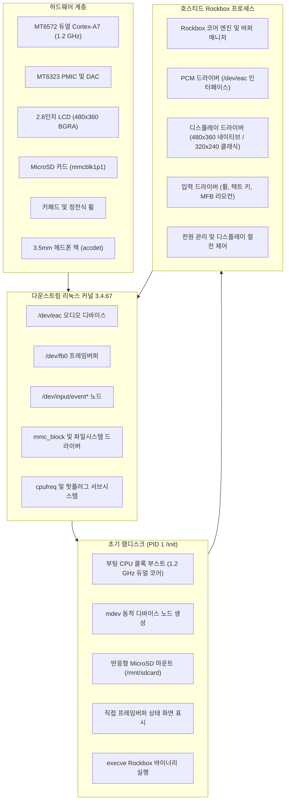
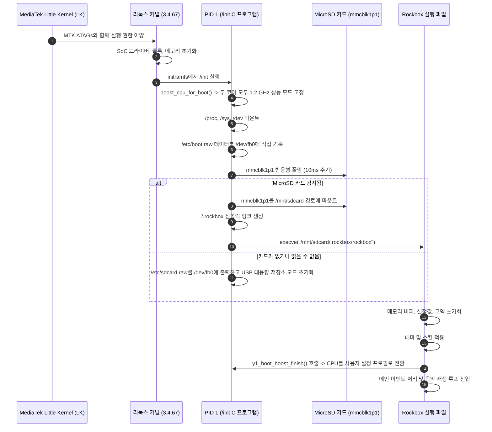

🌐 **한국어** | [English](../ARCHITECTURE.md)

# 시스템 아키텍처: Innioasis Y1 호스티드 리눅스 포트

이 문서는 다운스트림 미니멀 리눅스 기반 Innioasis Y1 Rockbox 포트의 소프트웨어 아키텍처, 프로세스 모델, 부팅 수명 주기 및 스토리지 레이아웃에 대해 상세히 설명합니다.

---

## 1. 시스템 블록 다이어그램



---

## 2. 부팅 시퀀스 및 프로세스 라이프사이클



---

## 3. 스토리지 계층 구조 및 파티션 구성

하드웨어는 내부 eMMC(`mmcblk0`)와 외부 MicroSD(`mmcblk1`)로 구성됩니다.

### 3.1 파티션 구성 체계
- `mmcblk0` (내부 eMMC): 순정 MediaTek 파티션(`BOOTIMG`, `RECOVERY`, `LOGO`, `SYSTEM`, `CACHE`, `DATA`)이 포함되어 있습니다. Rockbox는 `BOOTIMG` 파티션만 `boot_rockbox.img`(최대 6 MiB)로 덮어씁니다. eMMC의 나머지 파티션은 마운트되지 않은 상태로 유지됩니다.
- `mmcblk1p1` (외장 MicroSD): FAT32, exFAT, NTFS 또는 ext4 형식으로 포맷됩니다. Rockbox의 주 루트 스토리지 드라이브 역할을 수행합니다:
  ```text
  /mnt/sdcard/
  |-- .rockbox/
  |   |-- rockbox          # ELF ARM 하드 플로트 실행 파일
  |   |-- codecs/          # 오디오 디코더 (.codec)
  |   |-- rocks/           # 플러그인 및 뷰어 (.rock, .ovl)
  |   |-- fonts/           # UI 글꼴 (.fnt, .fnticons)
  |   |-- themes/          # 테마 설정 (.cfg)
  |   |-- wps/             # 재생 화면 스킨 (.wps, .sbs)
  |   |-- config.cfg       # 영구 저장 설정 파일
  |   `-- boot.raw         # 커스텀 부팅 스크린
  `-- Music/               # 음악 라이브러리
  ```

---

## 4. 하드웨어 추상화 계층 (HAL) 매핑

| 서브시스템 | 소스 파일 경로 | 기술적 역할 |
| :--- | :--- | :--- |
| PCM 오디오 | [`firmware/target/hosted/innioasis/y1/pcm-y1.c`](file:///c:/Users/dakirb/Documents/rom/!rockbox_fromsource/rockbox-master/rockbox-master/firmware/target/hosted/innioasis/y1/pcm-y1.c) | `/dev/eac`와 직접 통신. 44.1/48kHz 클록 전환 및 팝 노이즈 억제 처리. |
| 오디오 제어 | [`firmware/target/hosted/innioasis/y1/audio-y1.c`](file:///c:/Users/dakirb/Documents/rom/!rockbox_fromsource/rockbox-master/rockbox-master/firmware/target/hosted/innioasis/y1/audio-y1.c) | 헤드폰 앰프 아날로그 게인(+12dB) 및 음소거 GPIO 라인 제어. |
| CPU 주파수 | [`firmware/target/hosted/innioasis/y1/cpufreq-y1.c`](file:///c:/Users/dakirb/Documents/rom/!rockbox_fromsource/rockbox-master/rockbox-master/firmware/target/hosted/innioasis/y1/cpufreq-y1.c) | 거버너 관리, 코어 오프라인 처리, 화면 꺼짐 스로틀링 및 부팅 부스트 종료 처리. |
| LCD / 디스플레이 | [`firmware/target/hosted/innioasis/y1/lcd-y1.c`](file:///c:/Users/dakirb/Documents/rom/!rockbox_fromsource/rockbox-master/rockbox-master/firmware/target/hosted/innioasis/y1/lcd-y1.c) | 프레임버퍼 출력(`/dev/fb0`), 480x360 네이티브 / 320x240 스트레치 스케일링, 1 FPS AOD 리프레시. |
| 키패드 및 휠 | [`firmware/target/hosted/innioasis/y1/button-y1.c`](file:///c:/Users/dakirb/Documents/rom/!rockbox_fromsource/rockbox-master/rockbox-master/firmware/target/hosted/innioasis/y1/button-y1.c) | 클릭 휠 및 버튼에서 발생하는 `evdev` 이벤트를 Rockbox `BUTTON_*` 코드로 변환. |
| 전원 및 배터리 | [`firmware/target/hosted/innioasis/y1/power-y1.c`](file:///c:/Users/dakirb/Documents/rom/!rockbox_fromsource/rockbox-master/rockbox-master/firmware/target/hosted/innioasis/y1/power-y1.c) | MT6323 sysfs 인터페이스로부터 배터리 전압 및 충전 상태 수집. |