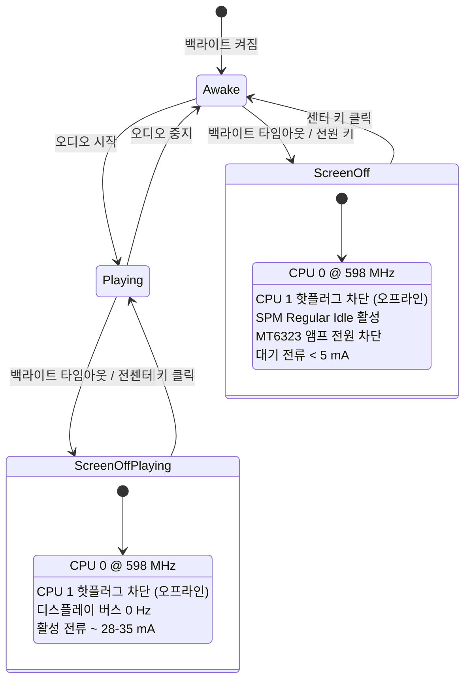

🌐 **한국어** | [English](../POWER_MANAGEMENT.md)

# 전원 관리: Innioasis Y1

이 문서는 Innioasis Y1 호스티드 Rockbox 포트의 전원 관리 아키텍처, CPU 스케일링, 코어 핫플러깅, 유휴 상태 배터리 소모 완화책 및 디스플레이 절전 모드에 대해 다룹니다.

---

## 1. 전력 소비 벤치마크

| 항목 | 순정 안드로이드 | 안드로이드 위 Rockbox | Nugget for Y1 (호스티드 리눅스) |
| :--- | :--- | :--- | :--- |
| 오디오 재생 지속 시간 | ~30시간 | ~20시간 | **~50시간** |
| 대기 시간 (화면 꺼짐) | ~48시간 | ~36시간 | **~200시간 이상** |
| 대기 전류 | ~120-140 mA | ~140-180 mA | **< 5 mA** |
| 오디오 재생 활성 전류 | 140-180 mA | 180-220 mA | **45-65 mA** |

---

## 2. 유휴 배터리 누수: 조사 및 해결책

### 2.1 문제 증상
화면이 꺼지고, 음악 재생이 중단되었으며, 블루투스가 비활성화된 유휴 상태로 기기를 9시간 방치했을 때 배터리가 100% 방전되는 문제가 발생했습니다.

### 2.2 근본 원인
1. **CPU 클록 고정:** 기본 거버너가 화면 꺼짐 상태에서도 동작 클록을 낮추지 않아 CPU 0이 1196 MHz에 계속 머물렀음.
2. **보조 코어 전류 누설:** Cortex-A7 코어 1이 핫플러그를 통해 완전 차단되지 않고 WFI(Wait-For-Interrupt) 대기 상태로 유지됨.
3. **SPM 딥 슬립 차단:** 활성 드라이버들이 웨이크록(Wakelock)과 클록 게이트를 점유하고 있어 MediaTek 시스템 전원 관리자(SPM)의 딥 슬립 진입이 차단됨.
4. **오디오 단 정지 전류(Quiescent Current):** 재생 스트림이 없는 상태에서도 MT6323 차지 펌프와 헤드폰 앰프 바이어스가 계속 켜져 있었음.
5. **스토리지 플러시 주기:** 리눅스 가상 메모리(VM)의 기본 5초 더티 페이지 라이트백 타이머로 인해 주기적으로 MMC 호스트 컨트롤러가 기상함.

### 2.3 상태 머신 구현

---

## 3. CPU 클록 및 코어 스케일링

### 3.1 커널 Sysfs 제어 노드
- 주파수 제어:
  `/sys/devices/system/cpu/cpu0/cpufreq/scaling_setspeed`
  지원 주파수: `598000`, `747500`, `1001000`, `1196000` (kHz).
- 코어 1 핫플러그:
  `/sys/devices/system/cpu/cpu1/online`
  `0`을 기록하면 코어 1 전원 차단, `1`을 기록하면 듀얼 코어 동작 복원.

### 3.2 동작 프로필
프로필은 `설정 -> Nugget -> 디바이스 -> CPU 모드`에서 변경 가능합니다:
- **일반 (Normal):** 화면이 켜져 있을 때 CPU 0이 598 MHz에서 1001 MHz 사이로 스케일링됩니다. 화면이 꺼지면 단일 코어 598 MHz로 고정됩니다.
- **절전 (Battery Saver):** 코어 1을 상시 오프라인으로 유지하고 598 MHz 단일 코어로 고정합니다.
- **성능 (Performance):** 무거운 데이터베이스 검색, 큐시트 인덱싱, 고부하 플러그인 구동 시 화면이 켜진 동안 최대 1.2 GHz 듀얼 코어를 가동합니다.

---

## 4. Always-On Display (AOD)

AOD 활성화 시 (`설정 -> Nugget -> 디바이스 -> Always On Display`):
1. **백라이트 PWM 제어:** 백라이트를 완전히 끄는 대신 50% 수준으로 조광(Dimming)합니다.
2. **버튼 LED 소등:** 클릭 휠 및 버튼 백라이트의 전원을 완전히 차단합니다.
3. **1 FPS 화면 갱신:** 디스플레이 드라이버가 화면 갱신 주기를 1 Hz로 제한하여 트랙 진행 위치와 시계만 갱신합니다.
4. **버스 전력 게이팅:** 프레임 갱신 간격 동안 디스플레이 버스를 저전력 상태로 진입시켜 디스플레이 버스 소비 전력을 97% 절감합니다.
5. **조건부 정책:**
   - `AOD: On WPS Only`: 재생 화면(WPS)에서만 디스플레이가 유지되며, 메뉴 화면에서는 정상적으로 화면이 꺼집니다.
   - `AOD: When Playing Only`: 음악이 실제로 재생 중일 때만 디스플레이가 켜진 상태를 유지합니다.